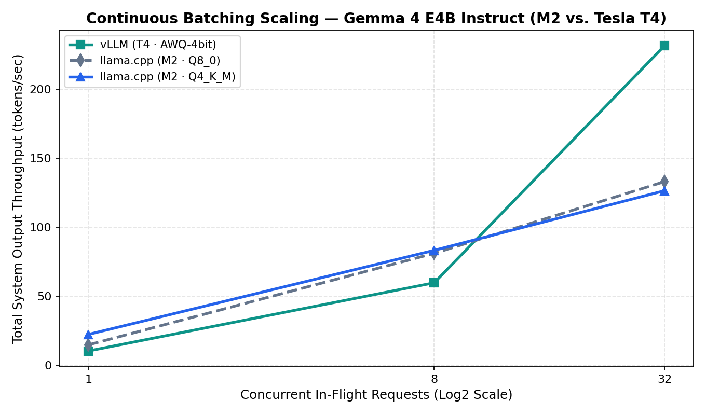
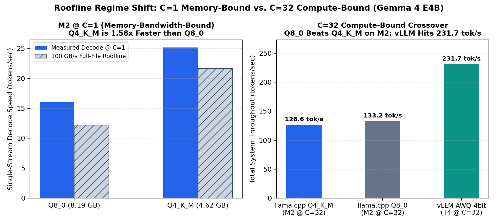
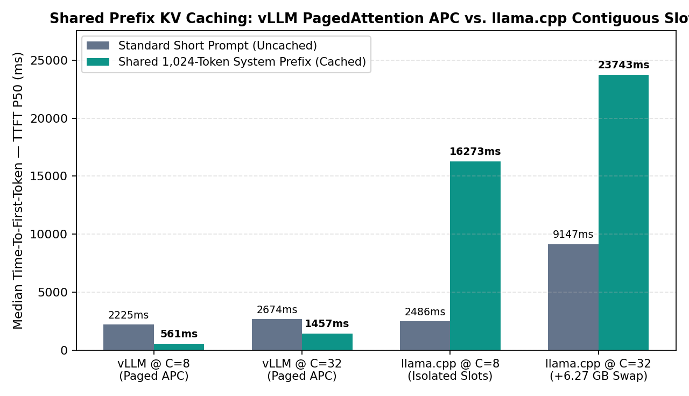

# Multi-Engine LLM Serving Benchmark (`vLLM` vs. `SGLang` vs. `llama.cpp` vs. `MLX`)

Empirical Roofline and concurrency benchmark comparing **vLLM**, **SGLang**, **llama.cpp**, and **Apple MLX** serving **Google Gemma 4 E4B Instruct (`google/gemma-4-E4B-it`, `7.5B` total parameters)** across **8-bit (`Q8_0`)** and **4-bit (`Q4_K_M` / `AWQ-4bit`)** quantization tiers and a **1 / 8 / 32** concurrency ladder on **Apple M2 (`16 GB Unified LPDDR5`, `100 GB/s`)** and **NVIDIA Tesla T4 (`16 GB GDDR6`, `320 GB/s`)**.

---

## 1. Key Engineering Findings

1. **Continuous Batching Scaling (`22.3x` on Tesla T4):** `vLLM` scaled total system throughput from **`10.41 tok/s` (`C=1`) to `231.71 tok/s` (`C=32`)** while keeping per-user decode speed flat (`10.49 → 10.01 tok/s`) and adding only `+346 MiB` of KV cache VRAM (`12,619 → 12,965 MiB`).
2. **PagedAttention APC vs. Contiguous Slot Caching (`16.3x` Faster P50 TTFT & `27.5x` Faster P99 TTFT at `C=32`):** Under a shared 1,024-token system prompt (`prefix_cache`), `llama.cpp` (`--cache-reuse 64`) duplicated the KV prefix across 32 isolated slot buffers—spilling **`+6.27 GB` to macOS SSD swap** (`P50 TTFT: 23,743 ms`, `P99 TTFT: 53,278 ms`). `vLLM` PagedAttention hashed and shared a single physical KV copy across all 32 workers with **`0 MB` extra VRAM**, cutting `C=8` P99 TTFT by **`15.0x` (`8,777.3 ms → 584.6 ms`)** and delivering a **`1,457.3 ms` P50 TTFT (`1,939.4 ms` P99)** at `C=32`.
3. **Compute-Bound Dequantization Crossover at `C=32` (`Q8_0` Overtakes `Q4_K_M`):** At `C=1` (memory-bandwidth-bound), `Q4_K_M` (`4.62 GiB`) streams **`1.58x` faster** than `Q8_0` (`8.19 GiB`) on Apple M2 (`25.19` vs. `15.99 tok/s`). At `C=32` (compute-bound), `Q4_K_M` bit-unpacking overhead in Metal shaders causes **`Q8_0` (`133.15 tok/s`) to outperform `Q4_K_M` (`126.56 tok/s`)**.
4. **Turing `sm_75` Hardware Ceiling (`64 KB` SRAM & `__CUDA_ARCH__ >= 800`):**
   - **`vLLM` Triton Kernel Fix:** `Gemma 4` uses `head_size = 512` in global attention layers. Default `TILE_SIZE = 32` requires $3 \times 32 \times 512 \times 2 = 98,304\text{ bytes}$ (`96 KB`) of shared memory per SM, exceeding the Tesla T4's `65,536 byte` (`64 KB`) SRAM limit. Clamping `TILE_SIZE = 16` and `launch_num_stages = 1` in `triton_unified_attention.py` reduced per-SM SRAM to `49,152 bytes` (`48 KB`), unlocking all 6 `vLLM` sweeps.
   - **`SGLang` Marlin C++ Gate:** Bypassing `SGLang v0.5.23`'s Python capability check (`Min capability: 80`) and loading all `9.70 GB` of weights (`11,911 MiB` VRAM) proved via `nvcc` JIT compilation (`gptq_marlin.cuh:973: error: namespace "sglang::device::marlin" has no member "marlin_mm"` under `-DSGL_CUDA_ARCH=750`) that `SGLang`'s W4A16 Marlin kernel requires Ampere (`__CUDA_ARCH__ >= 800`) tensor-core instructions.
   - **Apple `MLX` (`mlx_lm.server`):** Unbounded per-request Metal buffer wiring triggered a macOS IOGPU watchdog reset at `C=8`.

---

## 2. Measured Hardware Benchmark Table (`15 Sweeps`)

Full raw telemetry is stored in [`results/benchmark_summary.csv`](results/benchmark_summary.csv) and [`results/benchmark_results.jsonl`](results/benchmark_results.jsonl).

| Hardware Target | Engine | Quantization | Workload | `C` | System Throughput (`tok/s`) | Per-User Speed (`tok/s`) | TTFT P50 (`ms`) | TTFT P99 (`ms`) | TPOT P50 (`ms`) | Memory / Swap |
| :--- | :--- | :--- | :--- | :--- | :--- | :--- | :--- | :--- | :--- | :--- |
| **Apple M2 (16GB)** | `llama.cpp` | `Q4_K_M` | `standard` | `1` | `22.43` | **`25.19`** | `590.4` | `844.1` | **`39.7`** | `4.62 GiB` (`-c 65536`) |
| **Apple M2 (16GB)** | `llama.cpp` | `Q4_K_M` | `standard` | `8` | `83.34` | `13.04` | `2,486.4` | `2,811.7` | `76.7` | `+0.0 MB` swap |
| **Apple M2 (16GB)** | `llama.cpp` | `Q4_K_M` | `standard` | `32` | `126.56` | `5.54` | `9,147.1` | `11,558.5` | `180.2` | `+0.0 MB` swap |
| **Apple M2 (16GB)** | `llama.cpp` | `Q4_K_M` | `prefix_cache` | `1` | `21.56` | `23.41` | **`465.4`** | `623.6` | `42.7` | `+556.8 MB` swap |
| **Apple M2 (16GB)** | `llama.cpp` | `Q4_K_M` | `prefix_cache` | `8` | `36.85` | `11.45` | `16,272.9` | `30,361.1` | `86.5` | `+1,956.1 MB` swap |
| **Apple M2 (16GB)** | `llama.cpp` | `Q4_K_M` | `prefix_cache` | `32` | `65.62` | `3.91` | `23,743.2` | `53,278.2` | `261.8` | **`+6,266.9 MB` swap** |
| **Apple M2 (16GB)** | `llama.cpp` | `Q8_0` | `standard` | `1` | `14.87` | `15.99` | `651.9` | `657.5` | `62.6` | `8.19 GiB` (`-c 32768`) |
| **Apple M2 (16GB)** | `llama.cpp` | `Q8_0` | `standard` | `8` | `81.16` | `12.70` | `2,520.4` | `2,839.0` | `78.5` | `+17.8 MB` swap |
| **Apple M2 (16GB)** | `llama.cpp` | `Q8_0` | `standard` | `32` | **`133.15`** | `5.84` | `8,683.2` | `10,832.0` | `171.4` | `+0.0 MB` swap |
| **NVIDIA T4 (16GB)** | `vLLM` | `AWQ-4bit` | `standard` | `1` | `10.41` | `10.49` | **`192.4`** | `201.1` | `95.3` | `12,619 MiB` VRAM |
| **NVIDIA T4 (16GB)** | `vLLM` | `AWQ-4bit` | `standard` | `8` | `59.83` | `9.93` | `2,224.9` | `8,777.3` | `100.0` | `12,655 MiB` VRAM |
| **NVIDIA T4 (16GB)** | `vLLM` | `AWQ-4bit` | `standard` | `32` | **`231.71`** | **`10.01`** | `2,674.0` | `9,185.8` | `100.2` | `12,965 MiB` VRAM |
| **NVIDIA T4 (16GB)** | `vLLM` | `AWQ-4bit` | `prefix_cache` | `1` | `10.77` | `10.88` | `209.9` | `227.2` | `91.9` | `12,759 MiB` VRAM |
| **NVIDIA T4 (16GB)** | `vLLM` | `AWQ-4bit` | `prefix_cache` | `8` | **`81.71`** | `10.58` | **`561.5`** | **`584.6`** | `95.0` | `12,761 MiB` VRAM |
| **NVIDIA T4 (16GB)** | `vLLM` | `AWQ-4bit` | `prefix_cache` | `32` | **`189.01`** | **`6.30`** | **`1,457.3`** | **`1,939.4`** | `157.5` | `12,761 MiB` (`+0 MiB`) |

---

## 3. Benchmark Visualizations

### 3.1 Continuous Batching Throughput Scaling (`C = 1 → 8 → 32`)


### 3.2 Roofline Regime Shift (`C=1` Memory-Bound vs. `C=32` Compute-Bound)


### 3.3 Shared Prefix KV Caching (`vLLM` PagedAttention vs. `llama.cpp` Contiguous Slots)


---

## 4. Repository Structure & Reproduction

* [`harness/`](harness/) — Zero-bias async OpenAI SSE load generator (`TTFT`, `TPOT`, `ITL`, `E2E` nanosecond timers).
* [`scripts/mac/`](scripts/mac/) — Automated Apple Silicon orchestrator (`llama-server` & `mlx_lm.server`) with `sysctl vm.swapusage` telemetry.
* [`scripts/colab/`](scripts/colab/) & [`notebooks/colab_t4_benchmark.ipynb`](notebooks/colab_t4_benchmark.ipynb) — Automated NVIDIA Tesla T4 orchestrator (`vLLM` & `SGLang`) with `nvidia-smi` telemetry and Turing `sm_75` Triton SRAM patch.
* [`scripts/plot.py`](scripts/plot.py) — Generates the three charts in [`results/plots/`](results/plots/) from [`results/benchmark_summary.csv`](results/benchmark_summary.csv).
* [`docs/writeup.md`](docs/writeup.md) & [`docs/ROADMAP.md`](docs/ROADMAP.md) — Full technical case study and Roofline architecture specification.

```bash
# 1. Verify async SSE harness against local mock server
python3 -m harness.selftest

# 2. Run Apple Silicon M2 benchmark suite
python3 scripts/mac/run_mac_suite.py \
  --engine llama.cpp \
  --model-spec models/gemma-4-E4B-it-Q4_K_M.gguf \
  --quant Q4_K_M \
  --concurrencies "1,8,32" \
  --workload standard

# 3. Regenerate plots from CSV telemetry
python3 scripts/plot.py --csv results/benchmark_summary.csv
```
