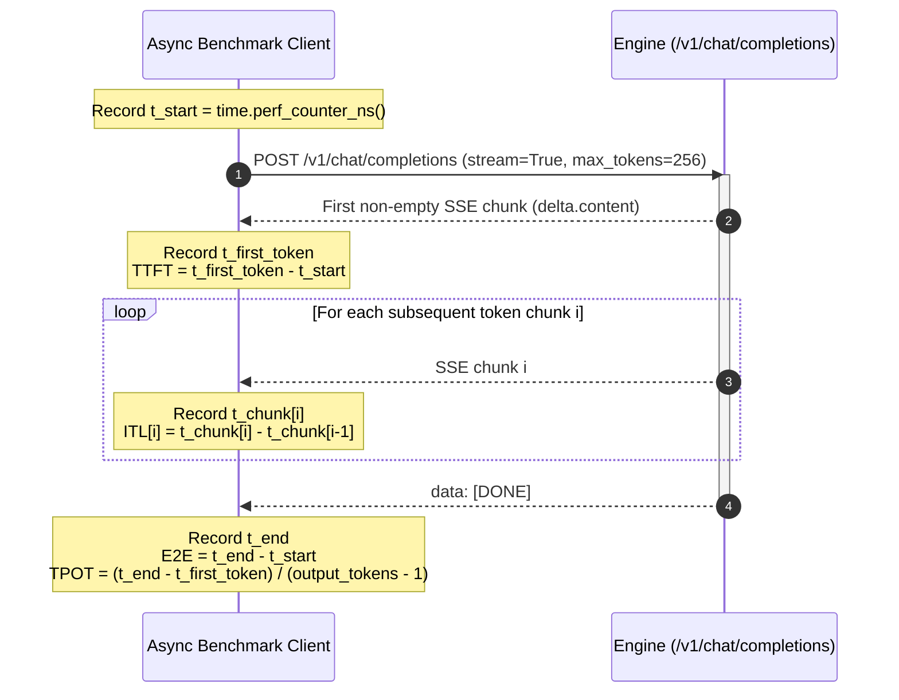

# Multi-Engine LLM Serving Benchmark

## 1. Feasibility & First-Principles Physics Check

### 1.1 Roofline Model: Apple M2 vs. NVIDIA Tesla T4
Every LLM inference request transitions through two distinct hardware bottlenecks:
1. **Prefill Phase (Prompt Ingestion):** Processes all $L_{\text{in}}$ input tokens in parallel via matrix-matrix multiplication (`GEMM`). High arithmetic intensity ($\text{FLOPs/Byte} \gg 100$) makes Prefill **Compute-Bound** — governed by peak `TFLOPS` and measured by **TTFT (Time To First Token)**.
2. **Decode Phase (Autoregressive Token Generation):** Generates 1 token per step via matrix-vector multiplication (`GEMV`) at batch size $B=1$. Low arithmetic intensity ($\approx 2 \text{ FLOPs/Byte}$) makes Decode **Memory-Bandwidth-Bound** — governed by memory bus speed (`GB/s`) and measured by **ITL / TPOT (Inter-Token Latency / Time Per Output Token)**.

$$\text{Theoretical Min TPOT (at } B=1\text{)} \approx \frac{\text{Model Weight Footprint (Bytes)}}{\text{Memory Bandwidth (Bytes/sec)}}$$

| Metric / Roofline Bound | Apple M2 (16 GB Unified) | NVIDIA Tesla T4 (16 GB GDDR6) | Expected Ratio (T4 vs. M2) |
| :--- | :--- | :--- | :--- |
| **Peak Memory Bandwidth** | `100 GB/s` | `320 GB/s` | `3.2x` faster single-stream ceiling on T4 |
| **Peak FP16 / BF16 Compute** | `~7.1 TFLOPS` | `~65.0 TFLOPS` | `~9.1x` faster prompt prefill on T4 |
| **Theoretical Max Decode (`Gemma-4-E4B` @ `Q4`, `2.3 GB`)** | $\approx 43 \text{ tok/s}$ (`23.0 ms` TPOT) | $\approx 139 \text{ tok/s}$ (`7.2 ms` TPOT) | Real-world engines achieve `70–85%` of roofline |
| **Theoretical Max Decode (`Gemma-4-E4B` @ `FP16`, `8.0 GB`)** | $\approx 12.5 \text{ tok/s}$ (`80.0 ms` TPOT) | $\approx 40 \text{ tok/s}$ (`25.0 ms` TPOT) | Quantization (`FP16` $\to$ `Q4`) yields `~3.4x` speedup |
| **Theoretical Max Decode (`Gemma-4-12B` @ `Q4`, `6.5 GB`)** | $\approx 15.3 \text{ tok/s}$ (`65.0 ms` TPOT) | $\approx 49 \text{ tok/s}$ (`20.3 ms` TPOT) | Sweet spot for 12B reasoning on 16 GB hardware |

---

## 2. The Benchmark Matrix (36 Core Cells + Ablations)

### 2.1 Primary Sweep (`Gemma 4 E4B Instruct`)
* **Engines (4):**
  * **Local Track (Apple M2):** `llama.cpp` (`llama-server`) vs. `MLX` (`mlx_lm.server`)
  * **Cloud Track (Colab T4):** `vLLM` vs. `SGLang`
* **Quantization Tiers (3):**
  * **16-bit:** `FP16` / `BF16` (`google/gemma-4-E4B-it`)
  * **8-bit:** `Q8_0` (`unsloth/gemma-4-E4B-it-GGUF`, `mlx-8bit`, `bitsandbytes/W8A8`)
  * **4-bit:** `Q4_K_M` / `QAT-Q4_0` / `AWQ-INT4` (`google/gemma-4-E4B-it-qat-q4_0-gguf`, `mlx-4bit`)
* **Concurrency Ladder (4):**
  * `C = 1` (Pure single-user memory-bandwidth test)
  * `C = 8` (Small team load; continuous batching onset)
  * `C = 32` (Production batching sweet spot; compute transition)
  * `C = 128` (KV cache saturation & scheduling stress test)

### 2.2 Secondary Stress Test (`Gemma 4 12B Instruct` @ `Q4` vs `Q8` vs `FP16`)
* Demonstrates the hard 16 GB VRAM wall (`FP16` = 24 GB OOM) and compares `Q4` (`6.5 GB`) vs `Q8` (`12.5 GB`) under `C = 1, 8, 32`.

### 2.3 Prefix Caching Ablation (`SGLang` RadixAttention vs. `vLLM` APC vs. `llama.cpp` `--cache-reuse`)
* Workload: 32 requests sharing a **1,024-token system prompt** (simulating RAG / agentic instructions) + unique 128-token user queries.
* Measures **TTFT reduction (%)** when KV states are reused vs. recomputed.

---

## 3. Unified Benchmark Harness Specification (`harness/`)

All four engines expose an OpenAI-compatible `/v1/chat/completions` endpoint supporting Server-Sent Events (`stream: true`).

### 3.1 Failure Mode Analysis (FMA) for Fair Benchmarking

| Potential Failure | Mitigation Strategy | Detection Method |
| :--- | :--- | :--- |
| **Cold-Start / JIT Compilation Bias** | Run 3 unmeasured warmup requests before starting the timed concurrency sweep. | Compare warmup request #1 TTFT against request #3 TTFT in debug logs. |
| **Tokenizer Mismatch Across Engines** | Pre-generate fixed prompt strings calibrated to exact token counts (`256` input tokens, `256` output tokens) and set `ignore_eos: true` (or fixed `min_tokens`/`max_tokens`). | Assert `output_tokens == target_tokens` on every response record. |
| **Client-Side Event Loop Bottleneck** | Use `aiohttp` or `httpx.AsyncClient` with `uvloop` and monotonic nanosecond timers (`time.perf_counter_ns`). | Monitor client CPU usage (`<30%` on a single core at `C=128`). |
| **OS Memory Swap Masking as GPU VRAM on Mac** | Track macOS `vm_stat` / `psutil` resident memory and wired Metal memory during each run. | Flag any run where macOS swap-ins increase above `0 MB`. |
