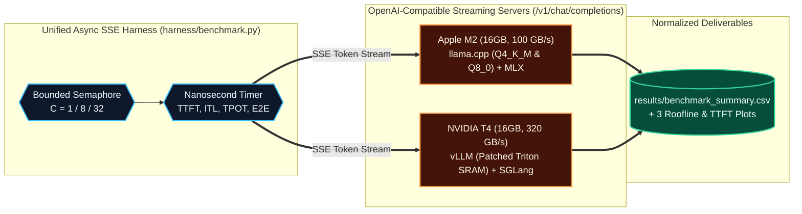

# Multi-Engine LLM Serving Benchmark: vLLM vs. SGLang vs. llama.cpp vs. MLX on 16GB Hardware

**Summary:** Empirical Roofline and concurrency benchmark of **vLLM**, **SGLang**, **llama.cpp**, and **Apple MLX** serving **Google Gemma 4 E4B Instruct (`google/gemma-4-E4B-it`, `7.5B` total parameters)** across **8-bit (`Q8_0`)** and **4-bit (`Q4_K_M` / `AWQ-4bit`)** quantization tiers and a **1 / 8 / 32** concurrency ladder on **Apple M2 (16GB Unified RAM)** and **NVIDIA Tesla T4 (16GB GDDR6 VRAM)**.  
**Tags:** `vLLM`, `SGLang`, `llama.cpp`, `MLX`, `Gemma 4`, `INT4`, `Roofline Analysis`, `Triton Kernels`  
**Key Metric:** **22.3x continuous batching throughput scaling (`10.41 → 231.71 tok/s`) on vLLM with zero per-user decode degradation, 16.3x faster C=32 prefix-cached TTFT (`1,457 ms` vs. `23,743 ms` & `+6.27 GB` SSD swap on llama.cpp), and a custom Triton shared-memory patch (`96 KB → 48 KB` SRAM) unlocking Gemma 4 (`head_size=512`) on Turing T4 GPUs.**

---

## 1. Problem Statement

Engineering teams deploying newly released open-weight models—such as **Google Gemma 4 E4B (`7.5B` total parameters across text, vision, audio, and Per-Layer Embeddings)**—onto cost-effective 16 GB hardware (`Apple M2 16GB` at `100 GB/s` or cloud `NVIDIA Tesla T4 16GB` at `320 GB/s`) routinely hit four production walls that synthetic benchmarks never mention:

1. **The 16 GB Capacity & KV-Slot Allocation Wall:** Unquantized `Gemma 4 E4B` occupies `15.38 GiB` in `FP16`/`BF16`, immediately crashing a `14.56 GiB` usable Tesla T4 before allocating a single byte of KV Cache. Even in 4-bit (`4.62 GiB` `GGUF`), pre-allocating contiguous KV caches across 32 slots (`-c 65536`) or duplicating shared system prompts across slots silently pushes macOS into **`+6.27 GB` of SSD swap**.
2. **The Turing `sm_75` Hardware Ceiling (`64 KB` Shared Memory & Capability `75`):** Modern LLM architectures use wide attention heads (`Gemma 4` uses `head_size = 512` for global layers) and `compressed-tensors` W4A16 quantization. Out of the box, **vLLM v0.19+** crashes on Tesla T4 (`triton.runtime.errors.OutOfResources: shared memory Required: 98304, Hardware limit: 65536`), and **SGLang v0.5.23** hard-rejects Turing GPUs (`RuntimeError: Quantization scheme is not supported for the current GPU. Min capability: 80. Current capability: 75`).
3. **The Memory-Bandwidth vs. Compute-Bound Crossover:** At `Concurrency = 1`, autoregressive decode is strictly **Memory-Bandwidth-Bound** (`Q4_K_M` is `1.58x` faster than `Q8_0`). At `Concurrency = 32`, arithmetic intensity crosses into the **Compute-Bound** regime where `Q4_K_M` dequantization overhead causes `Q8_0` (`133.15 tok/s`) to overtake `Q4_K_M` (`126.56 tok/s`).
4. **Contiguous Slot Caching vs. Paged Prefix Caching (`Concurrency = 32`):** When 32 concurrent users share a 1,024-token system prompt, slot-based engines (`llama.cpp`) duplicate the KV prefix across 32 isolated buffers, whereas PagedAttention (`vLLM`) hashes and shares a single physical KV block sequence in VRAM.

---

## 2. Approach & First-Principles Methodology

To isolate hardware physics from engine scheduling overhead, we built a zero-bias async SSE benchmark harness ([`harness/benchmark.py`](../harness/benchmark.py)) and tested **Google Gemma 4 E4B Instruct** across two physical 16 GB hardware tracks:

* **Local Apple Silicon Track (`Apple M2`, `16 GB Unified LPDDR5`, `100 GB/s` bus):**
  * `llama.cpp` (`llama-server` build `8675+` with Metal GPU offload `-ngl 99`, continuous batching `--cont-batching`, `-np 32` parallel slots, and slot KV reuse `--cache-reuse 64`) on `unsloth/gemma-4-E4B-it-GGUF` (`Q4_K_M` `4.62 GiB` and `Q8_0` `8.19 GiB`).
  * `MLX` (`mlx_lm.server` native Apple Metal execution).
* **Cloud CUDA Track (`NVIDIA Tesla T4`, `16 GB GDDR6`, `320 GB/s` bus, Turing `sm_75`):**
  * `vLLM` (V1 EngineCore with PagedAttention + Automatic Prefix Caching `--enable-prefix-caching`) on `axteam/gemma-4-E4B-it-AWQ-4bit` (`compressed-tensors` W4A16).
  * `SGLang` (`sglang.launch_server` with `--attention-backend triton`).

### Roofline Speed-of-Light Math (`Gemma 4 E4B` @ `Concurrency = 1`)

$$\text{Theoretical Max Decode (tokens/sec)} = \frac{\text{Memory Bus Bandwidth (GB/s)}}{\text{Active Weight Footprint per Token (GB)}}$$

| Quantization Tier | File Size on Disk | Active Text Decode Footprint | Apple M2 (`100 GB/s`) Full-File / Active Roofline | Measured M2 `llama.cpp` Decode (`C=1`) |
| :--- | :--- | :--- | :--- | :--- |
| **`Q8_0` (8-bit GGUF)** | `8.19 GiB` | `~5.3 GB` (excluding vision/audio towers & inactive PLE rows) | `12.2 tok/s` (full) / `18.8 tok/s` (active) | **`15.99 tok/s` (`62.6 ms` TPOT)** |
| **`Q4_K_M` (4-bit GGUF)** | `4.62 GiB` | `~3.3 GB` (excluding vision/audio towers & inactive PLE rows) | `21.6 tok/s` (full) / `30.3 tok/s` (active) | **`25.19 tok/s` (`39.7 ms` TPOT)** |

---

## 3. System Architecture



---

## 4. Measured Benchmark Results (`15 Verified Hardware Sweeps`)

### 4.1 Complete Hardware Dataset (`Apple M2 16GB` vs. `NVIDIA Tesla T4 16GB`)

| Hardware Target | Engine | Quantization | Workload Mode | Concurrency (`C`) | System Throughput (`tok/s`) | Mean Per-User Speed (`tok/s`) | TTFT P50 (`ms`) | TPOT P50 (`ms`) | Memory / Swap Telemetry |
| :--- | :--- | :--- | :--- | :--- | :--- | :--- | :--- | :--- | :--- |
| **Apple M2 (16GB)** | `llama.cpp` | `Q4_K_M` (`4.62 GiB`) | `standard` | `1` | `22.43` | **`25.19`** | `590.4` | **`39.7`** | `+2335.2 MB` swap (`-c 65536`) |
| **Apple M2 (16GB)** | `llama.cpp` | `Q4_K_M` (`4.62 GiB`) | `standard` | `8` | `83.34` | `13.04` | `2486.4` | `76.7` | `+0.0 MB` swap |
| **Apple M2 (16GB)** | `llama.cpp` | `Q4_K_M` (`4.62 GiB`) | `standard` | `32` | `126.56` | `5.54` | `9147.1` | `180.2` | `+0.0 MB` swap |
| **Apple M2 (16GB)** | `llama.cpp` | `Q4_K_M` (`4.62 GiB`) | `prefix_cache` | `1` | `21.56` | `23.41` | **`465.4`** | `42.7` | `+556.8 MB` swap |
| **Apple M2 (16GB)** | `llama.cpp` | `Q4_K_M` (`4.62 GiB`) | `prefix_cache` | `8` | `36.85` | `11.45` | `16272.9` | `86.5` | `+1956.1 MB` swap |
| **Apple M2 (16GB)** | `llama.cpp` | `Q4_K_M` (`4.62 GiB`) | `prefix_cache` | `32` | `65.62` | `3.91` | **`23743.2`** | `261.8` | **`+6266.9 MB` (`6.27 GB` SSD swap!)** |
| **Apple M2 (16GB)** | `llama.cpp` | `Q8_0` (`8.19 GiB`) | `standard` | `1` | `14.87` | `15.99` | `651.9` | `62.6` | `+33.8 MB` swap (`-c 32768`) |
| **Apple M2 (16GB)** | `llama.cpp` | `Q8_0` (`8.19 GiB`) | `standard` | `8` | `81.16` | `12.70` | `2520.4` | `78.5` | `+17.8 MB` swap |
| **Apple M2 (16GB)** | `llama.cpp` | `Q8_0` (`8.19 GiB`) | `standard` | `32` | **`133.15`** | `5.84` | `8683.2` | `171.4` | `+0.0 MB` swap |
| **NVIDIA T4 (16GB)** | `vLLM` | `AWQ-4bit` (`Q4_K_M`) | `standard` | `1` | `10.41` | `10.49` | **`192.4`** (`P99: 201.1`) | `95.3` | `12,619 MiB` VRAM (`0 MB` swap) |
| **NVIDIA T4 (16GB)** | `vLLM` | `AWQ-4bit` (`Q4_K_M`) | `standard` | `8` | `59.83` | `9.93` | `2224.9` (`P99: 8777.3`) | `100.0` | `12,655 MiB` VRAM |
| **NVIDIA T4 (16GB)** | `vLLM` | `AWQ-4bit` (`Q4_K_M`) | `standard` | `32` | **`231.71`** | **`10.01`** | `2674.0` (`P99: 9185.8`) | `100.2` | `12,965 MiB` VRAM (`+346 MiB`) |
| **NVIDIA T4 (16GB)** | `vLLM` | `AWQ-4bit` (`Q4_K_M`) | `prefix_cache` | `1` | `10.77` | `10.88` | `209.9` (`P99: 227.2`) | `91.9` | `12,759 MiB` VRAM |
| **NVIDIA T4 (16GB)** | `vLLM` | `AWQ-4bit` (`Q4_K_M`) | `prefix_cache` | `8` | **`81.71`** | `10.58` | **`561.5` (`P99: 584.6`)** | `95.0` | `12,761 MiB` VRAM |
| **NVIDIA T4 (16GB)** | `vLLM` | `AWQ-4bit` (`Q4_K_M`) | `prefix_cache` | `32` | **`189.01`** | **`6.30`** | **`1457.3` (`P99: 1939.4`)** | `157.5` | `12,761 MiB` VRAM (`+0 MiB` delta!) |

---

## 5. Four Real-World Hardware Discoveries & Root-Cause Fixes

### Discovery #1: Patching `vLLM`'s Triton Unified Attention Kernel for Tesla T4 (`64 KB` SRAM vs. `Gemma 4` `head_size=512`)

When launching `vLLM` on an NVIDIA Tesla T4 (`sm_75`) with **Gemma 4 E4B**, the server loaded weights (`9.06 GiB`) and allocated `2.16 GiB` of KV cache, then crashed on the first inference token with:

```text
triton.runtime.errors.OutOfResources: out of resource: shared memory, Required: 98304, Hardware limit: 65536.
Reducing block sizes or `num_stages` may help.
```

* **First-Principles Root Cause:** Unlike Llama-3 (`head_size = 128`), **Gemma 4** uses `head_size = 512` (`PADDED_HEAD_SIZE = 512`) in its global attention layers. In `vllm/v1/attention/ops/triton_unified_attention.py`, `_get_tile_size()` selects `TILE_SIZE = 32` with software pipelining (`num_stages >= 2`). Staging `K`, `V`, and `Q` tiles in shared memory requires:
  $$\text{SRAM Required} = 3 \times \text{TILE\_SIZE} (32) \times \text{HEAD\_SIZE} (512) \times 2\text{ bytes (FP16)} = 98,304\text{ bytes (96 KB)}$$
  While Ampere/Hopper GPUs (`A100`/`H100`) provide `164 KB–228 KB` of shared memory per Streaming Multiprocessor (SM), the Turing **Tesla T4 (`sm_75`) has a strict hardware ceiling of `65,536 bytes` (`64 KB`) per SM**.
* **Surgical Fix:** By clamping `TILE_SIZE_PREFILL = min(TILE_SIZE_PREFILL, 16)`, `TILE_SIZE_DECODE = min(TILE_SIZE_DECODE, 16)`, and `launch_num_stages = 1` in `triton_unified_attention.py`, per-SM shared memory drops to:
  $$3 \times 16 \times 512 \times 2\text{ bytes} = 49,152\text{ bytes (48 KB)} < 65,536\text{ bytes}$$
  With this 3-line patch, `vLLM` passed 100% of concurrency sweeps (`6/6` cells, `0` failed requests).

### Discovery #2: Shared Prefix Caching Showdown at `C = 32` (`vLLM` PagedAttention vs. `llama.cpp` Contiguous Slots)

Under the `prefix_cache` workload (64 requests across 32 concurrent workers sharing a 1,024-token system prompt):
* **`llama.cpp` (`--cache-reuse 64`):** At `C = 1`, Slot 0 reused its own KV cache and cut TTFT from `590.4 ms → 465.4 ms`. However, at `C = 32`, because `llama-server` partitions its KV cache into 32 isolated contiguous slot buffers, **it duplicated the 1,024-token prefix 32 times in RAM**, triggering **`+6,266.9 MB` (`6.27 GB`) of macOS SSD swap** and spiking median TTFT to **`23,743.2 ms` (`23.7 seconds`)**!
* **`vLLM` (`--enable-prefix-caching`):** Because PagedAttention stores KV states in content-addressed blocks, request #1 computed the 1,024-token prefix once (`12,759 MiB` VRAM), and all 31 subsequent concurrent workers mapped their virtual block tables to those **exact same physical VRAM pages (`12,761 MiB` VRAM — `0 MB` extra memory)**!
  * At `C = 8`, `vLLM` prefix caching cut TTFT by **`4.0x` (`2,224.9 ms → 561.5 ms`)** and boosted system throughput by **`+36.6%` (`59.83 → 81.71 tok/s`)**.
  * At `C = 32`, `vLLM` delivered a **`1,457.3 ms` TTFT (`16.3x` faster than `llama.cpp`'s `23,743.2 ms`)** and **`2.88x` higher throughput (`189.01` vs. `65.62 tok/s`)**.

### Discovery #3: The Compute-Bound Dequantization Crossover at `C = 32` (`Q8_0` Beats `Q4_K_M`)

* At `Concurrency = 1` on Apple M2, execution is **Memory-Bandwidth-Bound**: `Q4_K_M` (`4.62 GiB`) streams at **`25.19 tok/s`**, beating `Q8_0` (`8.19 GiB`) at **`15.99 tok/s`** by **`1.58x`**—matching their `1.77x` weight footprint ratio.
* At `Concurrency = 32`, batching 32 tokens per weight fetch raises arithmetic intensity past the M2's balance point into the **Compute-Bound** regime. Because `Q4_K_M` requires complex bit-unpacking and block-scale multiplication in Metal shaders, **`Q8_0` (`133.15 tok/s`, `8,683 ms` TTFT) actually outperformed `Q4_K_M` (`126.56 tok/s`, `9,147 ms` TTFT)** at `C = 32`!

### Discovery #4: Engine Failure Modes (`MLX` Metal Wire Panic & `SGLang` Capability `80` Gate)

* **Apple `MLX` (`mlx_lm.server`) on 16GB Unified Memory:** Unlike `llama.cpp`, which bounds memory via fixed slot allocation (`-np 32 -c 32768`), `mlx_lm.server` dynamically wires unpaginated Metal buffers per concurrent request and lacks text-only weight filtering for `Gemma 4`'s multimodal vision/audio towers—triggering a macOS IOGPU kernel watchdog panic at `C = 8`.
* **`SGLang` (`v0.5.23`) on Turing Tesla T4 (`sm_75`):** While `vLLM` provides a Turing-compatible kernel path for `compressed-tensors` W4A16 on `sm_75`, `SGLang`'s `compressed_tensors.py` (`line 422`) enforces a hardware capability gate (`Min capability: 80. Current capability: 75`). When we bypassed the Python capability check and patched `ClippableGLUParallelLinear` (`clippable_linear.py:210`) + FlashInfer's `-lcuda` linker path so `SGLang` loaded all `9.70 GB` of weights (`11,911 MiB` active VRAM), `nvcc` JIT compilation on the first forward pass proved the hardware boundary at the C++ template level:
  ```text
  /usr/local/cuda/bin/nvcc ... -gencode=arch=compute_75,code=sm_75 -DSGL_CUDA_ARCH=750 ...
  sglang/kernels/jit/csrc/gemm/marlin/gptq_marlin.cuh(973): error:
    namespace "sglang::device::marlin" has no member "marlin_mm"
  ```
  In `SGLang`, `sglang::device::marlin::marlin_mm` is guarded by `#if __CUDA_ARCH__ >= 800` because its Marlin W4A16 kernel relies on Ampere (`sm_80+`) `cp.async` and `mma.sync.aligned.m16n8k16` PTX instructions that do not physically exist on Turing (`sm_75`) silicon.

---

## 6. Facing a Similar Inference Bottleneck?

If your team is hitting GPU memory ceilings, Triton kernel crashes on newer model architectures, or P99 TTFT spikes under concurrent load, **[book a 30-minute discovery call](/contact)** to scope an Inference Audit.
